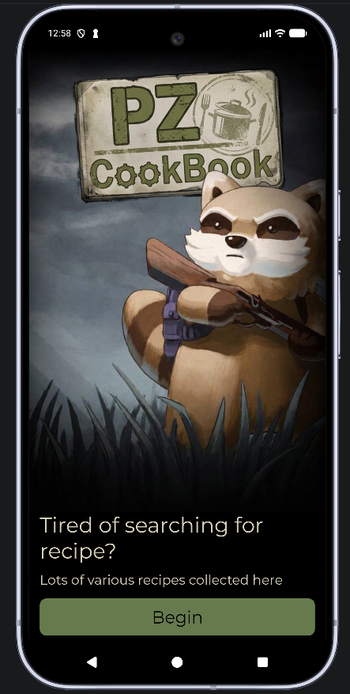

## 📱 App Preview

<table>
  <tr>
    <td align="center" width="50%">
      <h3>🚀 Onboarding Screen</h3>
      
First base iteration of the welcome screen featuring custom artwork and a quick-start action button.

      
    </td>
    <td align="center" width="50%">
      <h3>🍳 Main Screen</h3>
      
Main catalog featuring a search bar, category filters, and recipe cards with cooking times and difficulty.

      
    </td>
  </tr>
</table>
