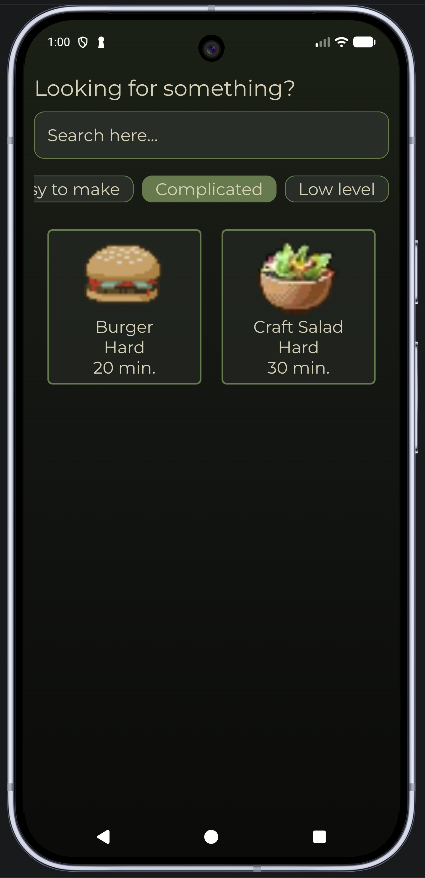
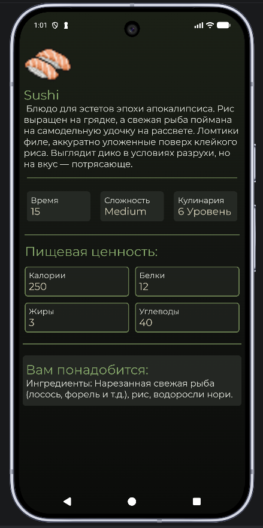
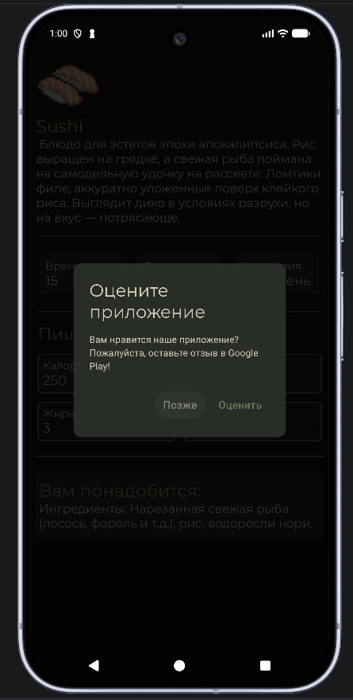

## 📱 App Preview

<table>
  <tr>
    <td align="center" width="50%">
      <h3>🚀 Onboarding Screen</h3>
      
First base iteration of the welcome screen featuring custom artwork and a quick-start button.

      
    </td>
    <td align="center" width="50%">
      <h3>🍳 Main Screen</h3>
      
Main catalog with a real-time search bar, category chips, and recipe cards with cooking times.

      
    </td>
  </tr>
  <tr>
    <td align="center" width="50%">
      <h3>🗂️ Categories Showcase</h3>
      
Dynamic category filtering (e.g., <i>Complicated</i>, <i>Low level</i>) to quickly sort recipes by skill and complexity.

      
    </td>
    <td align="center" width="50%">
      <h3>📖 Recipe Details</h3>
      
Detailed recipe card featuring lore description, required Cooking level, nutrition stats, and ingredients.

      
    </td>
  </tr>
  <tr>
    <td align="center" colspan="2">
      <h3>⭐ Rate the App Dialog</h3>
      
Non-intrusive in-app rating modal prompting users to leave feedback on Google Play.

      
    </td>
  </tr>
</table>
